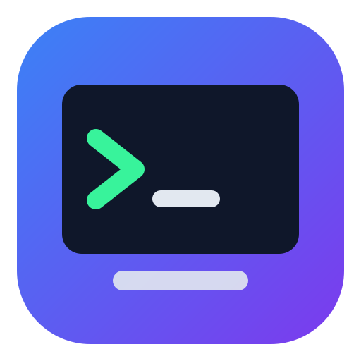
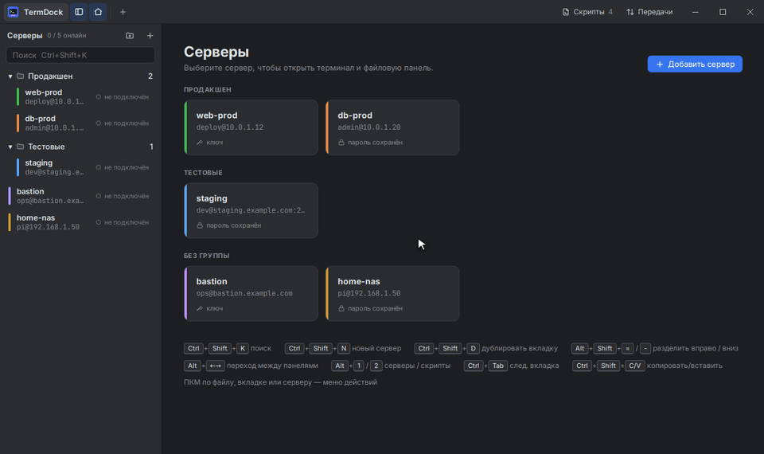
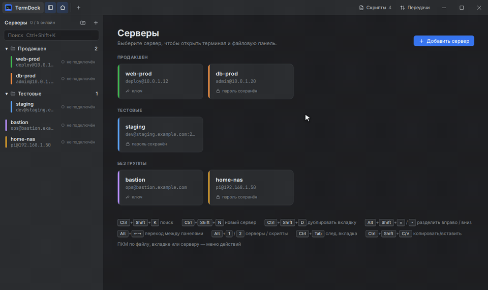
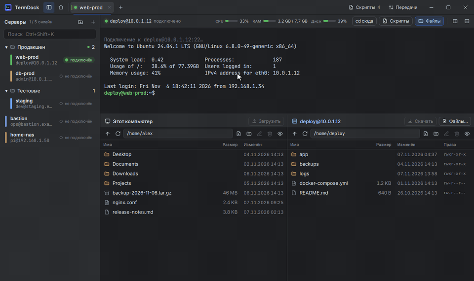
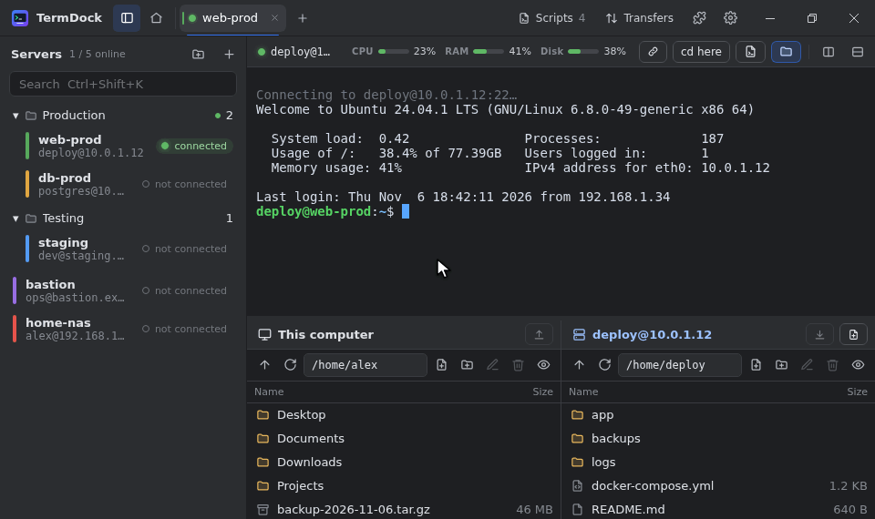
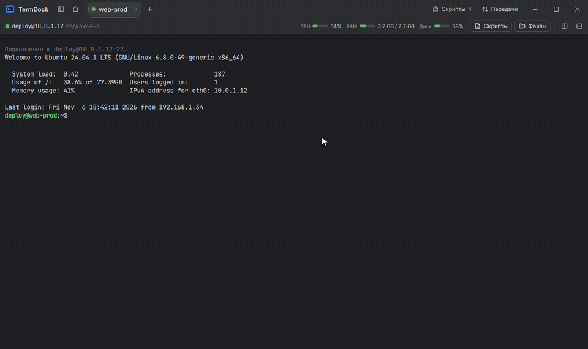

<div align="center">



# TermDock

[Русский](README.md) · **English**

**All your servers in one window: terminal, files and ready-made commands - without unnecessary configuration.**

Windows · Linux · free, open source

[**⬇ Download**](https://github.com/Vlad-Vershinin/TermDock/releases/latest) · [Quick start](#quick-start) · [Features](#features) · [Questions](#frequently-asked-questions)



</div>

> All gifs in this README are recorded from demo data: the servers, files and command output are not real.

---

## What is TermDock?

If you have a server - a VPS for a website, a home NAS, a Raspberry Pi or work machines - they usually work with it using **SSH**: open a terminal, enter the address, password and commands. And to upload the file, they launch another program.

**TermDock** collects all this into one application:

- 📋 **list of servers** - added once, then connect with one click;
- 💻 **terminal** - in tabs, you can open several nearby;
- 📁 **files** - computer on the left, server on the right, drag with the mouse;
- ⚡ **scripts** - save frequent commands and run them with a button on any server;
- 📊 **load** - you can immediately see how busy the processor, memory and disk are.

Passwords are stored in secure storage on your system, rather than in a regular file. There is no need to install anything additional - neither PuTTY, nor WinSCP, nor OpenSSH.

---

## Installation

Open the page [**Releases**](https://github.com/Vlad-Vershinin/TermDock/releases/latest) and download the file for your system (section **Assets** at the bottom of the page):

| Your system | Which file to download | How to install |
|---|---|---|
| **Windows 10 / 11** | `TermDock_…_x64-setup.exe` | Launch and click “Next” |
| **Ubuntu, Debian, Mint** | `TermDock_…_amd64.deb` | Double click on file or `sudo apt install ./TermDock_*.deb` |
| **Fedora, openSUSE** | `TermDock-…x86_64.rpm` | Double click on the file or `sudo dnf install ./TermDock-*.rpm` |
| **Arch Linux** | `termdock-…pkg.tar.zst` | `sudo pacman -U termdock-*.pkg.tar.zst` |
| **Any other Linux** | `TermDock_…_amd64.AppImage` | Make the file executable (`chmod +x`) and run |

> **Windows showed “Windows has protected your computer”?** This happens with programs without a paid digital signature. Click "More details" → "Run anyway".

The update is installed on top of the old version - the servers and settings will be preserved.

---

## Quick start

### 1. Add a server

Click **“Add server”** and fill in the fields:

- **Host** - server address, for example `192.168.1.10` or `example.com`. You can insert the whole thing at once: `user@example.com:2222` - the user and port will be filled in themselves.
- **User** - login on the server (for example, `root` or `ubuntu`).
- **Password** or **SSH-key** - how you log into the server. You don't have to specify a password - then TermDock will ask you for it when connecting.
- **Name** - what the server will be called in the list (optional).

Click **“Save and connect”**.



### 2. Confirm the server key (first time only)

When you connect for the first time, TermDock will show **the fingerprint of the server’s key** - this is its unique “passport”. If you are connecting to your server, just click **"Trust and connect"**. Next time there will be no question.

> ⚠️ If one day a red warning appears **“The server key has changed!”**, and you did not reinstall the server, do not connect and find out the reason. This is what an attempt to spoof a server looks like.

### 3. Open a session

On the left is a list of servers, on the top are tabs, and on the bottom are files. Click on the server to open it; Clicking again will switch to the already open tab.

---

## Features

### 📁 Drag-and-drop file transfers

There are two panels under the terminal: **“This computer”** and **server**. Drag a file or folder from one to another and it will be copied. The download progress can be seen in the **"Transfers"** window.



- Files can be dragged and **directly from Explorer** (or other file manager) - into the server panel or even into the terminal. And vice versa: drag the file out of TermDock outside the window and drop it into a folder or on the desktop. Files from the server will first be downloaded to a temporary folder (the process is visible in “Transfers”); If you release the button before it downloads, just drag it again.
- **From server to server** - open two servers side by side (see [“Multiple terminals”](#-split-terminals)) and drag the file from the panel of one server to the panel of the other. Or right-click on the file → “Copy to another server.” The files go directly without being saved on your computer.
- Drop the file **into the folder** - it will end up in it.
- **Double clicking** on a file copies it to the other side: from the computer to the server, from the server to the computer.
- **`F4`** or right click → “Edit” opens a text file in the **built-in editor**: corrected the config, clicked `Ctrl+S` - done.
  - **Syntax highlighting** - YAML, JSON, nginx, Dockerfile, shell, Python, JavaScript, SQL, INI/`.env`, systemd units and much more; the language is determined by the file name.
  - **Search and replace** - `Ctrl+F` / `Ctrl+H`.
  - **Any encoding** - the encoding is determined by itself (UTF-8, Windows-1251, KOI8-R, UTF-16...). If the text looks “crazy”, click “Open in...” at the bottom of the editor and select another one. The file is saved in the same encoding as it was.
  - **Large files** - up to 5 MB are opened immediately, up to 100 MB - after confirmation.
  - The editor preserves indentations, line endings and file permissions and will not allow you to close the file without saving.
- **Right click** on the file - all actions: download, rename, delete, copy path, create file or folder.
- The **“cd here”** button takes the terminal to the folder opened in the file panel.

### ⚡ Run saved commands in one click

Update the system, deploy the site, look at the logs - save the commands once (**“Scripts”** in the upper right corner or `Alt+2`) and run with the ▶ button on any server.



- **Entire** - all commands are executed in a row. A `sudo` password prompt or a `[Y/n]` confirmation cannot consume the commands that follow.
- **In steps** - commands are sent one at a time **“Next”** (`Ctrl+Shift+Enter`); convenient when you want to check the result of each step. **"All Others"** will send the remainder immediately.
- **Variables** - write `{{service}}` or `{{service:nginx}}` (with the default value) in the script, and before launching TermDock will ask what to substitute.
- **Like a bash script** - all the text is executed by one program `bash`: loops, functions and `set -e` work.
- **Script when connecting** - in the server settings you can select a script that will run itself every time you log in (for example, `sudo apt update`).

The default mode is set in the script itself; Right-clicking on the script in the panel allows you to select “Run as a whole” or “Run step by step”.

### 🪟 Split terminals

Open two servers in one tab or a second connection to the same server - for example, to view logs in one window and work in the other.



- **Right click on the server** → “Open on the right / bottom in the current tab.”
- Split buttons in the panel above the terminal, or `Alt+Shift+=` (right) and `Alt+Shift+-` (down).
- Up to 4 panels in a tab, borders can be moved with the mouse, `Alt+arrow keys` - transition between panels.
- Ctrl-click a server or `Ctrl+Shift+D` is another tab with the same server.
- **Drag a tab onto an open terminal** to place it next to it; the highlighted half shows which side. The connection stays open.
- **Reorder tabs** by dragging them along the tab strip.
- **Double-click a tab** to rename it (the server keeps its name). An empty name restores the server name.

### 🔗 Links in the terminal

Click a link to open it in the browser, even when the program on the server split a long address over several lines. **Right-click a link** to copy it whole, as one line.

If the link is a browser sign-in that has to return to a program on the server (`redirect_uri=http://localhost:…`, as Claude Code and MCP servers do), TermDock forwards that port for you, so the sign-in completes.

### 📊 Server load

Above the terminal you can always see the loading of the **processor**, the occupied **memory** and the space on the **disk** - green, yellow or red. Clicking on the indicator will show details: **load of each CPU core**, all disks, swap, operating time, system version. The data is collected separately and nothing is printed to the terminal. Works for servers on **Linux, macOS, FreeBSD and Windows** (with OpenSSH).

### 🗂 Organize your servers

- **Folders** - for example, “Work” and “Home”. Create - with the button above the list or right click; move the server - drag it onto the folder. Folders can be collapsed.
- **Colors** - each server has its own color mark so as not to confuse the production server with the test one.
- **Search** - `Ctrl+Shift+K`, start entering the name, `Enter` - connect.
- **Status** for each server: connected, connecting, error, disconnected.
- The left panel can be extended over the edge or hidden (`Alt+1`).

### 🔐 Jump hosts

It happens that the server cannot be reached directly - only through another server (bastion). In the server settings, enable **“Connection through an intermediary server”** and select a server from your list or enter a new one. You can build chains: the intermediary can also go through the intermediary. This is the same as `ssh -J`.

If you have already configured `ProxyJump` in `~/.ssh/config`, TermDock will pick it up itself - a prompt “From ~/.ssh/config: via …” will appear in the server window. The short hostnames (`Host` + `HostName`) from this file also work. The mediator specified in TermDock itself is more important than the settings from the file.

### 🔌 Port forwarding

Do you need to open a database or web panel that is only accessible from the server? In the server settings, open **“Port forwarding”** and add the rule:

- **Local** (`-L`) - a port on your computer leads to an address on the server side. For example, `localhost:5433` → `127.0.0.1:5432` on the server - and your database program connects to `localhost:5433`.
- **Remote** (`-R`) - a port on the server leads to an address on your computer. For example, to show the server the local web server.
- **SOCKS proxy** (`-D`) is a port on a computer through which you can launch a browser: sites will open as the server sees them.

Forwards are started on every connection. The **“Ports”** button above the terminal shows which ones are working, allows you to stop them or add a temporary forwarding only for this session.

### 🔑 Passwords and keys

- Login using **password**, **SSH-key** (OpenSSH / PEM, including with a key password) or through **SSH-agent** (`ssh-agent`, OpenSSH agent in Windows, Pageant) - then TermDock does not need to know either the password or the key at all.
- Passwords are stored in the system storage: **Credential Manager** Windows, **GNOME Keyring** or **KWallet** in Linux. They do not go into the settings files.
- TermDock takes your `~/.ssh/known_hosts` into account if you have one.

### 🧩 Plugins

Plugins add their own commands, panels and automation: for example, automatic answers to terminal prompts or a panel with server info.

- **The puzzle button** in the title bar → “Manage plugins…” → “Install from folder…” or “Install from .zip…”. Plugins are enabled, disabled and removed there too.
- Before installing, TermDock shows **what the plugin is allowed to do**: read terminal output, type commands, run commands on the server, read or change files. Uncheck what you don't want.
- Plugin commands are in the **palette** `Ctrl+Shift+P`, in right-click menus and under the “Plugins” button above the terminal.
- Plugins run in an isolated sandbox: they can't see passwords or keys and can't go online. But a plugin allowed to run commands can do anything on a server that you can, so install plugins only from sources you trust.

Ready examples are in [`examples/plugins`](examples/plugins); to write your own, see the [plugin author docs](docs/plugins/README.en.md).

---

## ⚙️ Settings and language

The gear in the top right corner (or `Ctrl+,`) opens the settings. Changes apply immediately:

- **Interface language** — English or Russian.
- **Interface scale** — if everything looks too small or too large.
- **Terminal** — font, font size, line height, cursor style and blinking, scrollback length, right-click behaviour, copy on select.
- **Files** — downloads folder (also per server: server settings → "Advanced"), whether to ask for a folder every time, hidden files, the folder the "This computer" pane opens in.

In the **Transfers** window a finished file has **Show in folder** and **Open** buttons.

## Keyboard shortcuts

The most useful: `Ctrl+Shift+K` - find a server, `Ctrl+Shift+N` - new server, `Alt+2` - scripts, `Ctrl+Shift+C` / `Ctrl+Shift+V` - copy / paste in the terminal. Right click on anything - action menu.

<details>
<summary><b>All hotkeys</b></summary>

| Keys | Action |
|---|---|
| `Ctrl+Shift+K` | Search for a server (`Enter` - connect to the first one) |
| `Ctrl+Shift+N` | New server |
| `Ctrl+,` | Settings |
| `Ctrl+Shift+P` | Plugin command palette |
| `Ctrl+Tab` / `Ctrl+Shift+Tab` | Next / previous tab |
| `Ctrl+Alt+1…9` | Go to tab by number |
| `Ctrl+Shift+W` | Close the panel (the last one - together with the tab) |
| `Ctrl+Shift+D` | Duplicate tab (new connection to the same server) |
| `Alt+Shift+=` / `Alt+Shift+-` | Split right / down |
| `Alt+←/→/↑/↓` | Transition between tab panels |
| `Alt+1` / `Alt+2` | Show / hide server / script panel |
| `Ctrl+Shift+Enter` | The next script command when run in steps |
| `Ctrl+Shift+C` / `Ctrl+Shift+V` | Copy / paste in terminal |
| Right click in terminal | Copy selection or paste |
| `Ctrl+=` / `Ctrl+-` / `Ctrl+0` | Larger / smaller / normal terminal font |
| `Enter` in a disconnected terminal | Reconnect |
| Files: `Enter`, `Backspace`, `Delete`, `F2`, `F4`, `F5`, `Ctrl+A` | Open, up, delete, rename, edit, update, select all |
| Editor: `Ctrl+S`, `Esc`, `Tab` | Save, close, tab |

</details>

---

## Frequently asked questions

<details>
<summary><b>Where can I get the server address, login and password?</b></summary>

They are issued by the hosting provider when purchasing a VPS (usually in a letter or in your personal account) or by the server administrator. For home devices, the address can be found in the router settings, and the login and password can be found in the device instructions.
</details>

<details>
<summary><b>Does not connect - what to check?</b></summary>

- Are the address and **port** specified correctly (the default is 22, but many hosting sites have a different one).
- Is SSH enabled on the server and is the port not blocked by a firewall?
- If the server is accessible only from the internal network, you need a VPN or [intermediary server](#-jump-hosts).
- The error text is visible directly in the terminal; `Enter` - try again.
</details>

<details>
<summary><b>Password is not saved in Linux</b></summary>

You need a working password storage service - **GNOME Keyring** or **KWallet**. Regular desktops (GNOME, KDE, Cinnamon, etc.) already have it; in minimalist environments it may need to be installed.
</details>

<details>
<summary><b>Where are my servers and settings stored? How to transfer them to another computer?</b></summary>

The list of servers, folders and scripts is in the files `servers.json`, `folders.json` and `scripts.json`:

- Windows: `%APPDATA%\dev.termdock.app\`
- Linux: `~/.config/dev.termdock.app/`

There `known_hosts` - confirmed server keys. Copy the folder to another computer and the servers will appear there. Passwords are not copied (they are in the system storage, service `TermDock`) - they will need to be entered again.
</details>

<details>
<summary><b>Is it safe?</b></summary>

TermDock connects to servers directly via SSH - the same protocol as the regular `ssh`. Passwords are stored in a secure system storage, server keys are checked every time you connect. The source code is open - you can view it in this repository.
</details>

---

## Current limitations

- `Match` blocks and `ProxyCommand` from `~/.ssh/config` are not supported.
- Temporary port forwarding added by the "Ports" button disappears after reconnection - set permanent ones in the server settings.
- The load on OpenBSD and NetBSD is not shown.

---

## For developers

TermDock is written in **Tauri 2 + Rust** (SSH and SFTP via `russh`, without external `ssh.exe`) and **React + TypeScript** (terminal on xterm.js).

<details>
<summary><b>Building from sources</b></summary>

Requires Rust (stable) and Node.js 20+.

**Ubuntu / Debian:**
```bash
sudo apt install build-essential pkg-config libssl-dev libwebkit2gtk-4.1-dev \
  libayatana-appindicator3-dev librsvg2-dev libxdo-dev libdbus-1-dev
npm ci
npx tauri build --bundles deb,appimage
```

**Arch Linux:**
```bash
cd packaging/arch
makepkg -si
```

**Windows** (you need Visual Studio Build Tools with the “Desktop development with C++” component and WebView2 - Windows 10/11 already has it):
```powershell
npm ci
npx tauri build --bundles nsis,msi
```

**Development mode:** `npm ci && npx tauri dev`.

The assembly results are in `src-tauri/target/release/bundle/`.

Ready-made packages are collected by GitHub Actions (`.github/workflows/build.yml`) when pushing the `v*` tag or manually via *Run workflow*; for tags, a release with text from `.github/release-notes.md` is published.
</details>

<details>
<summary><b>Project structure</b></summary>

```
src/                    React + TypeScript
  App.tsx tabs and panels, hotkeys, receiving files from the OS
  components/
    TitleBar.tsx window title: tabs, tools, window buttons
    TabView.tsx tab with split panels
    Sidebar.tsx list of servers with statuses
    ServerDialog.tsx adding/editing server
    SessionView.tsx terminal (xterm.js) + connection
    Telemetry.tsx CPU/RAM/server disk
    Scripts.tsx scripts: panel, editor, launch
    FilePanel.tsx two-panel file manager
    Editor.tsx editor wrapper (loaded on request)
    CodeEditor.tsx editor on CodeMirror: highlighting, search, encodings
    Ports.tsx port forwarding in the session panel
  lib/
    api.ts calls to Rust commands
    ui.tsx dialogs, notifications, context menu
    scripts.ts variable substitution, input preparation
    dnd.ts              drag & drop
    transfers.tsx transfer queue
    dragout.ts dragging files from application to OS
    termlinks.ts terminal links, including ones split over several lines
    plugins/ plugin host (sandbox, permissions) and plugin.json parsing
    codemirror.ts languages, theme and editor encodings
src-tauri/src/          Rust
  ssh.rs connection, authentication (password, key, agent), known_hosts, shell, exec
  sshconfig.rs reading ~/.ssh/config (Host, HostName, ProxyJump…)
  forward.rs port forwarding: -L, -R, SOCKS5
  stats.rs collection and analysis of telemetry (Linux, macOS, FreeBSD, Windows)
  files.rs local/remote files, transfers (including server → server), text reading/writing
  textcodec.rs encoding detection and conversion
  dragout.rs temporary folders for dragging into OS
  scripts.rs saved scripts
  store.rs saved servers and passwords
  plugins.rs plugin installation, the tdplugin:// scheme, plugin data
  lib.rs Tauri commands
packaging/arch/ PKGBUILD for Arch Linux
docs/media/ gifs for README
docs/plugins/ docs for plugin authors
examples/plugins/ example plugins
```
</details>

---

<div align="center">

Distributed under license [MIT](LICENSE).

</div>
