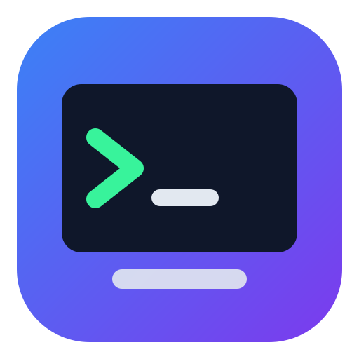
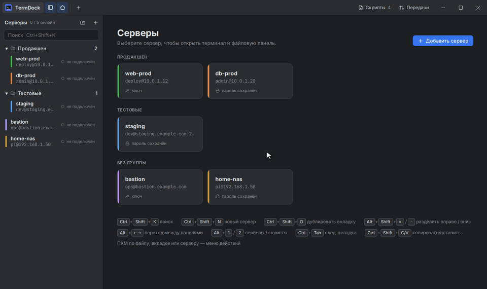
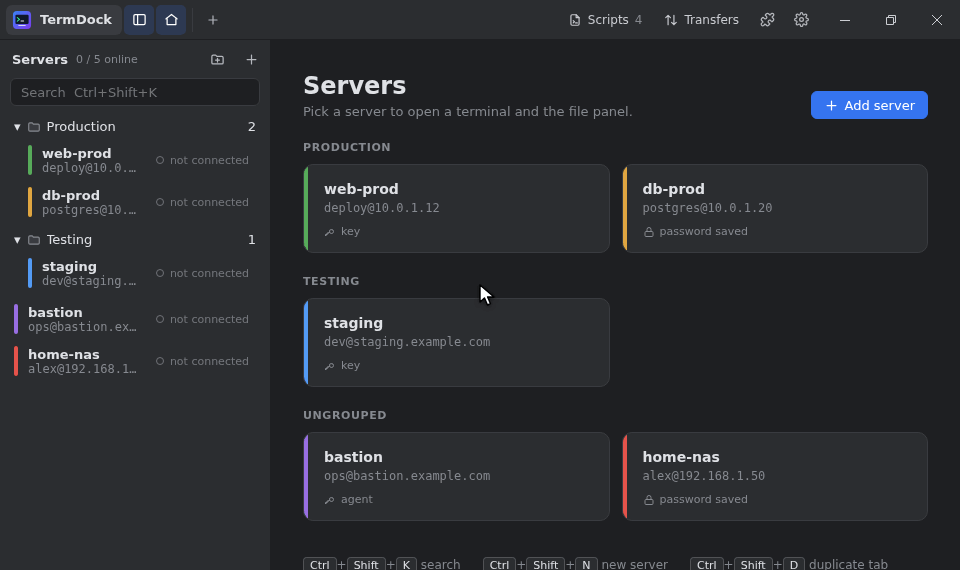
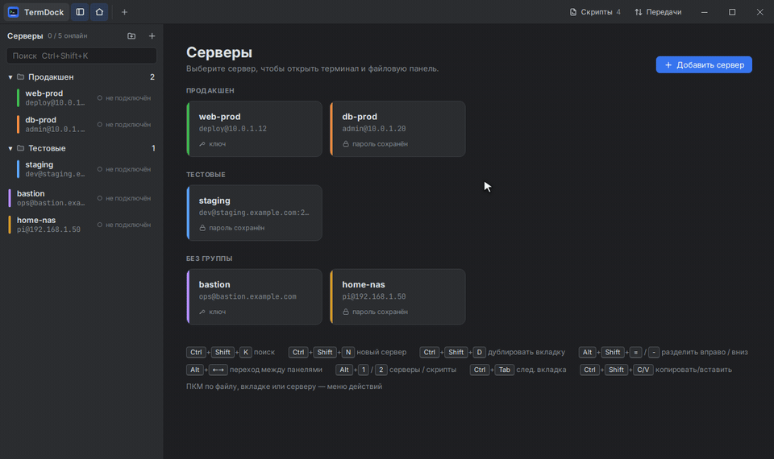
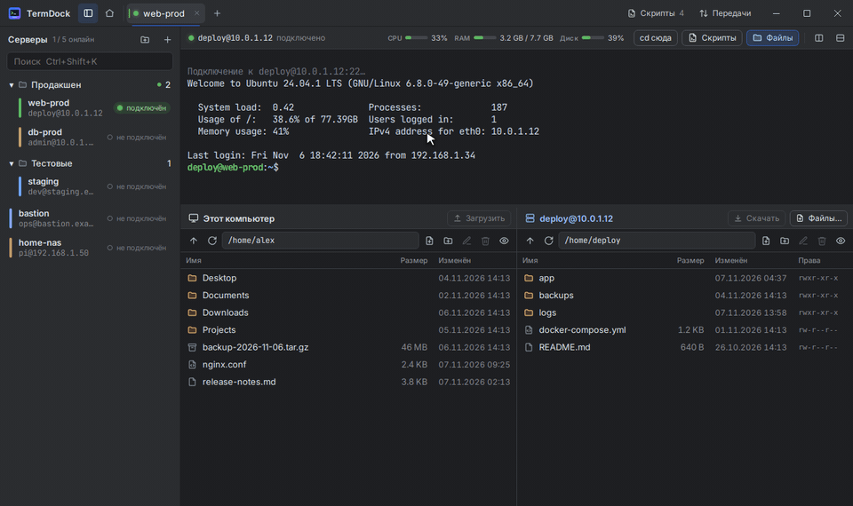
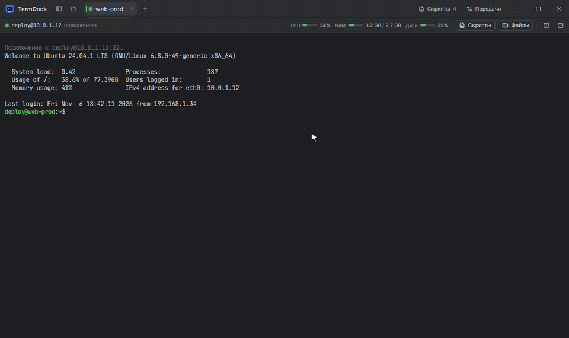
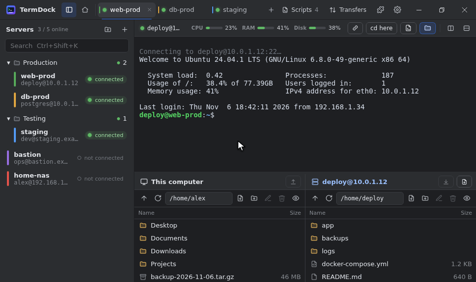
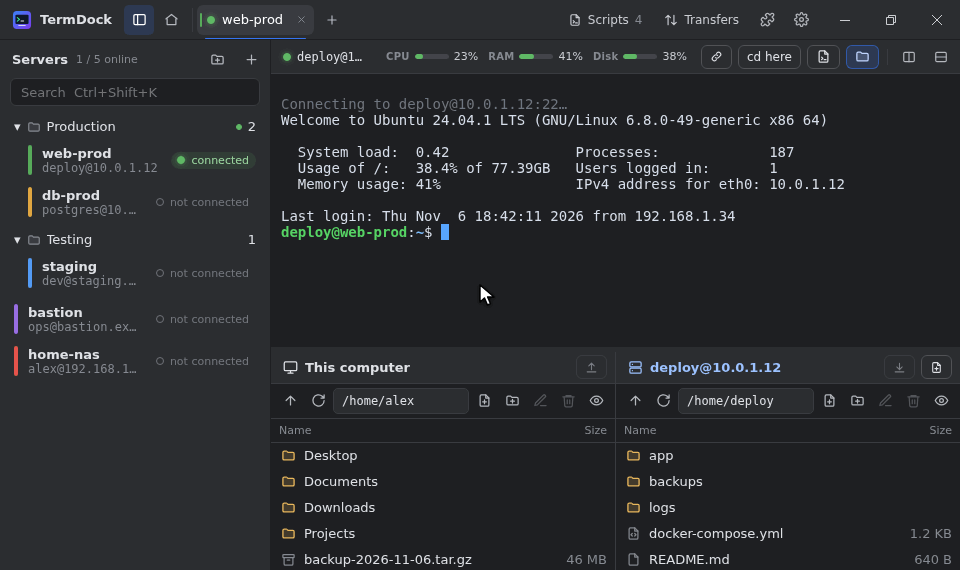
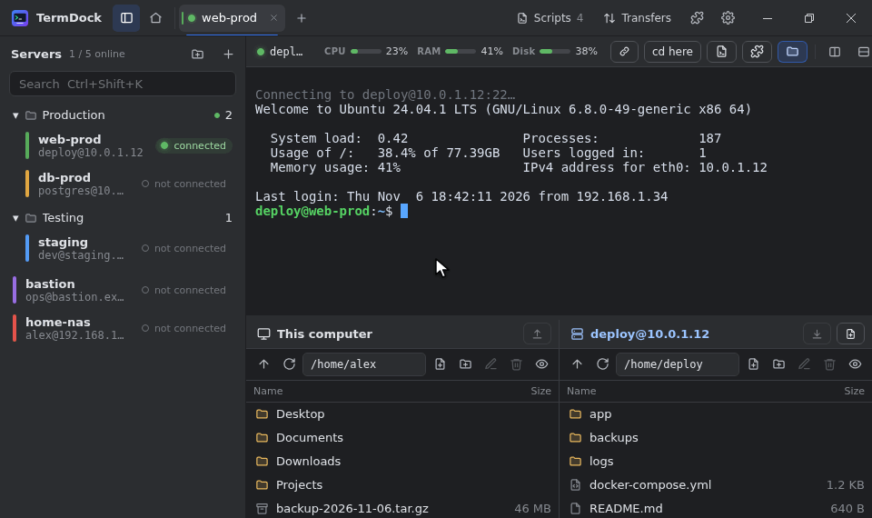

<div align="center">



# TermDock

**English** · [Русский](README.ru.md)

**All your servers in one window: terminals, files and saved commands, with no setup to fight.**

A free, open-source SSH client for Windows and Linux. No account, no subscription.

[**⬇ Download**](https://github.com/Vlad-Vershinin/TermDock/releases/latest) · [Quick start](#quick-start) · [Features](#features) · [FAQ](#frequently-asked-questions)



</div>

> All GIFs in this README use demo data: the servers, files and command output are not real.

---

## What is TermDock?

If you have a server (a VPS for a website, a home NAS, a Raspberry Pi or machines at work), you usually manage it over **SSH**: open a terminal, type the address, the password and then commands. To upload a file, you start yet another program.

**TermDock** puts all of this into one app:

- 📋 **server list**: add a server once, then connect with one click;
- 💻 **terminals** in tabs, several side by side;
- 📁 **files**: your computer on the left, the server on the right, drag and drop between them;
- ⚡ **scripts**: save frequent commands and run them on any server with one button;
- 📊 **server load**: CPU, memory and disk usage at a glance;
- 🧩 **plugins**: add your own commands, panels and automation.

Passwords are kept in your system's secure storage, not in a plain file. Nothing else to install: no PuTTY, WinSCP or OpenSSH needed. It's built with Tauri and Rust rather than Electron, so the Windows installer is under 5 MB.

---

## Installation

Open the [**Releases**](https://github.com/Vlad-Vershinin/TermDock/releases/latest) page and download the file for your system (under **Assets** at the bottom):

| Your system | File to download | How to install |
|---|---|---|
| **Windows 10 / 11** | `TermDock_…_x64-setup.exe` | Run it and click "Next" |
| **Ubuntu, Debian, Mint** | `TermDock_…_amd64.deb` | Double-click the file or `sudo apt install ./TermDock_*.deb` |
| **Fedora, openSUSE** | `TermDock-…x86_64.rpm` | Double-click the file or `sudo dnf install ./TermDock-*.rpm` |
| **Arch Linux** | `termdock-…pkg.tar.zst` | `sudo pacman -U termdock-*.pkg.tar.zst` |
| **Any other Linux** | `TermDock_…_amd64.AppImage` | Make the file executable (`chmod +x`) and run it |

> **Windows says "Windows protected your PC"?** That happens with apps that don't have a paid code-signing certificate. Click "More info" → "Run anyway".

**Updates install themselves.** TermDock checks for a new version at startup and every hour. When one is out, an "Update to …" button appears in the title bar: click it, and TermDock downloads and installs the new version, then restarts. On Linux, deb, rpm and Arch packages ask for the admin password. You can turn the check off in the settings, "Updates" section. Installing a new version over the old one by hand still works. Either way, your servers and settings are kept.



---

## Quick start

### 1. Add a server

Click **"Add server"** and fill in:

- **Host**: the server address, such as `192.168.1.10` or `example.com`. You can paste it all at once, `user@example.com:2222`, and the user and port fill themselves in.
- **User**: your login on the server (for example, `root` or `ubuntu`).
- **Password** or **SSH key**: how you sign in. You can leave the password empty, and TermDock asks for it when connecting.
- **Name**: how the server appears in the list (optional).

Click **"Save and connect"**.



### 2. Confirm the server key (first time only)

On the first connection TermDock shows **the server's key fingerprint**, its unique ID. If this is your server, click **"Trust and connect"**. You won't be asked again.

> ⚠️ If you ever see a red **"The server key has changed!"** warning and you didn't reinstall the server, don't connect: find out why first. This is what an attempt to impersonate your server looks like.

### 3. Open a session

Servers are on the left, tabs at the top, files at the bottom. Click a server to open it; clicking it again switches to its open tab.

---

## Features

### 📁 Drag-and-drop file transfers

Below the terminal there are two panes: **"This computer"** and the **server**. Drag a file or folder from one to the other to copy it. Progress is shown in the **"Transfers"** window.



- Drag files **straight from Explorer** (or any file manager) into the server pane or even into the terminal. It works the other way too: drag a file out of TermDock and drop it into a folder or onto the desktop. Server files are downloaded to a temporary folder first (you can watch it in "Transfers"); if you let go before the download finishes, just drag again.
- **Server to server**: open two servers side by side (see ["Split terminals"](#-split-terminals)) and drag a file from one server's pane to the other's, or right-click the file → "Copy to another server". Files go directly, without being saved on your computer.
- Drop a file **onto a folder** to put it inside.
- **Double-click** a file to copy it to the other side: computer to server or server to computer.
- **`F4`** or right-click → "Edit" opens a text file in the **built-in editor**: fix the config, press `Ctrl+S`, done.
  - **Syntax highlighting** for YAML, JSON, nginx, Dockerfile, shell, Python, JavaScript, SQL, INI/`.env`, systemd units and more; the language is picked from the file name.
  - **Search and replace**: `Ctrl+F` / `Ctrl+H`.
  - **Any encoding**: detected automatically (UTF-8, Windows-1251, KOI8-R, UTF-16…). If the text looks garbled, click "Reopen with…" at the bottom of the editor and pick another one. The file is saved back in its original encoding.
  - **Large files**: up to 5 MB open right away, up to 100 MB after a confirmation.
  - The editor keeps indentation, line endings and file permissions, and won't let you close a file without saving.
- **Right-click** a file for every action: download, rename, delete, copy path, new file or folder.
- The **"cd here"** button moves the terminal to the folder open in the file pane.

### ⚡ Run saved commands in one click

Update the system, deploy a site, check the logs: save the commands once (**"Scripts"** in the top right corner, or `Alt+2`) and run them on any server with the ▶ button.


- **All at once**: the commands run one after another. A `sudo` password prompt or a `[Y/n]` question can't swallow the commands that follow.
- **Step by step**: commands are sent one at a time with **"Next"** (`Ctrl+Shift+Enter`), handy when you want to check each result. **"All the rest"** sends the remaining commands at once.
- **Variables**: write `{{service}}` or `{{service:nginx}}` (with a default value) in a script, and TermDock asks what to fill in before running it.
- **Like a bash script**: the whole text runs in one `bash`, so loops, functions and `set -e` work.
- **Connect script**: in the server settings you can pick a script that runs every time you connect (for example, `sudo apt update`).

Each script has a default mode; right-click a script in the panel to choose "Run all at once" or "Run step by step".

### 🪟 Split terminals

Open two servers in one tab, or a second connection to the same server: for example, watch logs in one pane and work in the other.



- **Right-click a server** → "Open to the right in this tab" or "Open below in this tab".
- Split buttons above the terminal, or `Alt+Shift+=` (right) and `Alt+Shift+-` (down).
- Up to 4 panes per tab; drag the borders to resize, `Alt+arrow keys` to move between panes.
- Ctrl-click a server or press `Ctrl+Shift+D` for another tab with the same server.
- **Drag a tab onto an open terminal** to place it next to it; the highlighted half shows which side. The connection stays open.
- **Reorder tabs** by dragging them along the tab strip.
- **Double-click a tab** to rename it (the server keeps its name). An empty name brings the server name back.



### 🔗 Links in the terminal

Click a link to open it in the browser, even when the program on the server split a long address over several lines. **Right-click a link** to copy it whole, as one line.

If the link is a browser sign-in that has to come back to a program on the server (`redirect_uri=http://localhost:…`, as Claude Code and MCP servers do), TermDock forwards that port for you, so the sign-in completes.



### 📊 Server load

Above the terminal you always see **CPU** load, **memory** use and **disk** space, in green, yellow or red. Click the indicator for details: **load per CPU core**, all disks, swap, uptime, OS version. The data is collected on a separate channel, so nothing is printed into your terminal. Works with servers running **Linux, macOS, FreeBSD and Windows** (with OpenSSH).

### 🗂 Organize your servers

- **Folders**, such as "Work" and "Home". Create one with the button above the list or by right-clicking; drag a server onto a folder to move it. Folders can be collapsed.
- **Colors**: give each server its own color so you never mix up production and test.
- **Search**: `Ctrl+Shift+K`, start typing the name, `Enter` to connect.
- **Status** for each server: connected, connecting, error, disconnected.
- The left panel can be resized by dragging its edge or hidden (`Alt+1`).

### 🔐 Jump hosts

Sometimes a server can't be reached directly, only through another server (a bastion). In the server settings, open **"Connect through a jump server"** and pick a server from your list or enter a new one. Chains work too: a jump host can itself go through another one. It's the same as `ssh -J`.

If you already have `ProxyJump` in `~/.ssh/config`, TermDock picks it up: the server window shows "From ~/.ssh/config: via …". Short host names (`Host` + `HostName`) from that file work as well. A jump host set in TermDock takes priority over the file.

### 🔌 Port forwarding

Need to reach a database or web panel that is only available from the server? In the server settings, open **"Port forwarding"** and add a rule:

- **Local** (`-L`): a port on your computer leads to an address on the server's side. For example, `localhost:5433` → `127.0.0.1:5432` on the server, and your database client connects to `localhost:5433`.
- **Remote** (`-R`): a port on the server leads to an address on your computer, for example to show the server a local web server.
- **SOCKS proxy** (`-D`): a port on your computer to point a browser at; sites open as the server sees them.

Forwards start on every connection. The **"Ports"** button above the terminal shows which ones are running, lets you stop them, or add a temporary forward for this session only.

### 🔑 Passwords and keys

- Sign in with a **password**, an **SSH key** (OpenSSH / PEM, passphrase-protected too) or through an **SSH agent** (`ssh-agent`, the Windows OpenSSH agent, Pageant), in which case TermDock never needs your password or key at all.
- Passwords are kept in the system's secure storage: **Credential Manager** on Windows, **GNOME Keyring** or **KWallet** on Linux. They never go into settings files.
- TermDock respects your `~/.ssh/known_hosts` if you have one.

### 🧩 Plugins

Plugins add their own commands, panels and automation: for example, automatic answers to terminal prompts or a panel with server info.



- **The puzzle button** in the title bar → "Manage plugins…" → "Install from folder…" or "Install from .zip…". Plugins are enabled, disabled and removed there too.
- Before installing, TermDock shows **what the plugin is allowed to do**: read terminal output, type commands, run commands on the server, read or change files. Uncheck what you don't want.
- Plugin commands are in the **command palette** (`Ctrl+Shift+P`), in right-click menus and under the "Plugins" button above the terminal.
- Plugins run in an isolated sandbox: they can't see passwords or keys and can't go online. But a plugin allowed to run commands can do anything on a server that you can, so install plugins only from sources you trust.

Example plugins are in [`examples/plugins`](examples/plugins); to write your own, see the [plugin author guide](docs/plugins/README.en.md).

---

## ⚙️ Settings and language

The gear in the top right corner (or `Ctrl+,`) opens the settings; pick a section on the left. Changes apply immediately:

- **Interface**: language (English or Russian), interface font size (the text of menus, panels and lists; the terminal keeps its own), and interface scale if everything looks too small or too large.
- **Terminal**: font, font size, line height, cursor style and blinking, scrollback length, right-click behavior, copy on select.
- **Files**: downloads folder (also per server: server settings → "Advanced"), whether to ask for a folder every time, hidden files, the folder the "This computer" pane opens in.
- **Updates**: automatic update check and a "Check now" button.

In the **Transfers** window a finished file has **Show in folder** and **Open** buttons.

## Keyboard shortcuts

The most useful ones: `Ctrl+Shift+K` to find a server, `Ctrl+Shift+N` for a new server, `Alt+2` for scripts, `Ctrl+Shift+C` / `Ctrl+Shift+V` to copy / paste in the terminal. Right-click anything for its action menu.

<details>
<summary><b>All shortcuts</b></summary>

| Keys | Action |
|---|---|
| `Ctrl+Shift+K` | Find a server (`Enter` connects to the first match) |
| `Ctrl+Shift+N` | New server |
| `Ctrl+,` | Settings |
| `Ctrl+Shift+P` | Plugin command palette |
| `Ctrl+Tab` / `Ctrl+Shift+Tab` | Next / previous tab |
| `Ctrl+Alt+1…9` | Go to tab by number |
| `Ctrl+Shift+W` | Close the pane (the last one closes the tab) |
| `Ctrl+Shift+D` | Duplicate tab (new connection to the same server) |
| `Alt+Shift+=` / `Alt+Shift+-` | Split right / down |
| `Alt+←/→/↑/↓` | Move between panes in a tab |
| `Alt+1` / `Alt+2` | Show / hide the server / script panel |
| `Ctrl+Shift+Enter` | Next script command in step-by-step mode |
| `Ctrl+Shift+C` / `Ctrl+Shift+V` | Copy / paste in the terminal |
| Right-click in the terminal | Copy the selection or paste |
| `Ctrl+=` / `Ctrl+-` / `Ctrl+0` | Larger / smaller / default terminal font |
| `Enter` in a disconnected terminal | Reconnect |
| Files: `Enter`, `Backspace`, `Delete`, `F2`, `F4`, `F5`, `Ctrl+A` | Open, go up, delete, rename, edit, refresh, select all |
| Editor: `Ctrl+S`, `Esc`, `Tab` | Save, close, indent |

</details>

---

## Frequently asked questions

<details>
<summary><b>Where do I get the server address, login and password?</b></summary>

Your hosting provider sends them when you rent a VPS (usually by email or in your account dashboard), or ask the server's administrator. For devices at home, the address is in your router's settings, and the login and password are in the device's manual.
</details>

<details>
<summary><b>It won't connect. What should I check?</b></summary>

- Are the address and **port** right? The default is 22, but many hosting providers use another one.
- Is SSH enabled on the server, and is the port open in its firewall?
- If the server is only reachable from an internal network, you need a VPN or a [jump host](#-jump-hosts).
- The error is shown right in the terminal; press `Enter` to try again.
</details>

<details>
<summary><b>My password isn't saved on Linux</b></summary>

You need a running password storage service: **GNOME Keyring** or **KWallet**. Regular desktops (GNOME, KDE, Cinnamon and others) already have one; minimal setups may need to install it.
</details>

<details>
<summary><b>Where are my servers and settings stored? How do I move them to another computer?</b></summary>

Servers, folders and scripts are in `servers.json`, `folders.json` and `scripts.json`:

- Windows: `%APPDATA%\dev.termdock.app\`
- Linux: `~/.config/dev.termdock.app/`

The same folder has `known_hosts`, the server keys you confirmed. Copy the folder to another computer and your servers appear there. Passwords aren't copied (they live in the system storage, service `TermDock`), so you'll enter them again.
</details>

<details>
<summary><b>Is it safe?</b></summary>

TermDock connects to servers directly over SSH, the same protocol the regular `ssh` command uses. Passwords are kept in the system's secure storage, and server keys are checked on every connection. The source code is open: it's all in this repository.
</details>

---

## Current limitations

- `Match` blocks and `ProxyCommand` in `~/.ssh/config` aren't supported.
- Temporary port forwards added with the "Ports" button are lost on reconnect; set permanent ones in the server settings.
- Server load isn't shown for OpenBSD and NetBSD.
- No macOS build yet.

---

## For developers

TermDock is built with **Tauri 2 + Rust** (SSH and SFTP via `russh`, no external `ssh` binary) and **React + TypeScript** (the terminal is xterm.js).

<details>
<summary><b>Building from source</b></summary>

You need Rust (stable) and Node.js 20+.

**Ubuntu / Debian:**
```bash
sudo apt install build-essential pkg-config libssl-dev libwebkit2gtk-4.1-dev \
  libayatana-appindicator3-dev librsvg2-dev libxdo-dev libdbus-1-dev
npm ci
npx tauri build --bundles deb,appimage
```

**Arch Linux:**
```bash
cd packaging/arch
makepkg -si
```

**Windows** (you need Visual Studio Build Tools with the "Desktop development with C++" workload, and WebView2, which Windows 10/11 already has):
```powershell
npm ci
npx tauri build --bundles nsis,msi
```

**Development mode:** `npm ci && npx tauri dev`.

Build output goes to `src-tauri/target/release/bundle/`.

Release packages are built by GitHub Actions (`.github/workflows/build.yml`) when a `v*` tag is pushed, or by hand via *Run workflow*; for tags, a release is published with the text from `.github/release-notes.md`.
</details>

<details>
<summary><b>Project structure</b></summary>

```
src/                    React + TypeScript
  App.tsx               tabs and panes, shortcuts, files dropped from the OS
  components/
    TitleBar.tsx        window title bar: tabs, tools, window buttons
    TabView.tsx         a tab with split panes
    Sidebar.tsx         server list with statuses
    ServerDialog.tsx    add / edit a server
    SessionView.tsx     terminal (xterm.js) + connection
    Telemetry.tsx       server CPU / RAM / disk
    Scripts.tsx         scripts: panel, editor, running
    FilePanel.tsx       two-pane file manager
    Editor.tsx          editor wrapper (loaded on demand)
    CodeEditor.tsx      CodeMirror editor: highlighting, search, encodings
    Ports.tsx           port forwarding in the session bar
    Plugins.tsx         plugin manager, command palette, plugin sidebar
  lib/
    api.ts              calls to Rust commands
    ui.tsx              dialogs, toasts, context menu
    scripts.ts          variable substitution, input preparation
    dnd.ts              drag & drop
    transfers.tsx       transfer queue
    dragout.ts          dragging files out of the app into the OS
    termlinks.ts        terminal links, including ones split over several lines
    updates.tsx         update check and update dialog
    plugins/            plugin host (sandbox, permissions) and plugin.json parsing
    codemirror.ts       editor languages, theme and encodings
src-tauri/src/          Rust
  ssh.rs                connection, authentication (password, key, agent), known_hosts, shell, exec
  sshconfig.rs          reads ~/.ssh/config (Host, HostName, ProxyJump…)
  forward.rs            port forwarding: -L, -R, SOCKS5
  stats.rs              telemetry collection and parsing (Linux, macOS, FreeBSD, Windows)
  files.rs              local / remote files, transfers (including server → server), text read / write
  textcodec.rs          encoding detection and conversion
  dragout.rs            temporary folders for dragging out to the OS
  scripts.rs            saved scripts
  store.rs              saved servers and passwords
  plugins.rs            plugin installation, the tdplugin:// scheme, plugin data
  updater.rs            app updates from GitHub releases
  lib.rs                Tauri commands
packaging/arch/         PKGBUILD for Arch Linux
docs/media/             GIFs for the README
docs/plugins/           docs for plugin authors
examples/plugins/       example plugins
```
</details>

---

<div align="center">

Released under the [MIT](LICENSE) license.

</div>
